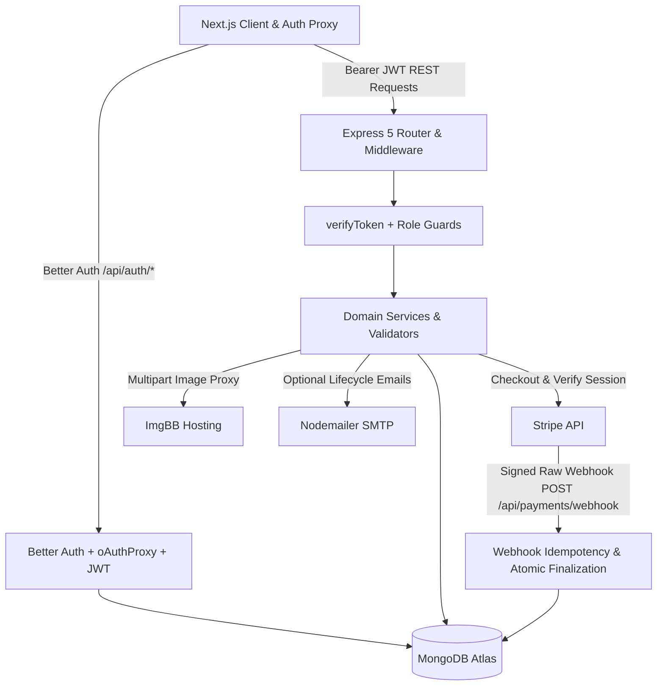

<div align="center">

# GearNest API — Equipment Rental Platform Backend

**The secure REST engine powering the GearNest rental marketplace.**

Express.js 5 & MongoDB Atlas API providing Better Auth identity, cryptographic JWKS JWT & RBAC authorization, inventory moderation, conflict-free date reservations, Stripe Hosted Checkout, signed webhook fulfillment, and role-isolated analytics.

<p>
  <a href="https://b14-a-009-server.onrender.com/api/health">
    
  </a>
  <a href="https://b14-a-009-client.vercel.app">
    
  </a>
  <a href="https://github.com/iRfANhAiDeRABiR/b14-A-009-client">
    
  </a>
</p>

<p>
  
  
  
  
  
</p>

[API Health](https://b14-a-009-server.onrender.com/api/health) · [Readiness Probe](https://b14-a-009-server.onrender.com/api/health/ready) · [Client Application](https://b14-a-009-client.vercel.app) · [Client Repository](https://github.com/iRfANhAiDeRABiR/b14-A-009-client)

</div>

---

## Table of Contents

- [Overview](#-overview)
- [System Architecture](#-system-architecture)
- [Core Capabilities](#-core-capabilities)
- [Technology Stack & Packages](#-technology-stack--packages)
- [Database Collections & Indexes](#-database-collections--indexes)
- [Authentication & RBAC](#-authentication--rbac)
- [API Reference](#-api-reference)
- [Getting Started](#-getting-started)
- [Environment Configuration](#-environment-configuration)
- [Available Scripts & Testing](#-available-scripts--testing)
- [Project Structure](#-project-structure)

---

## Overview

**GearNest API** handles all trusted business logic, authorization, transactional consistency, and financial integrity for the GearNest platform:

- Never trusts frontend prices, totals, owner IDs, or payment confirmation flags.
- Verifies Bearer JWT signatures cryptographically against live Better Auth JWKS keys **and** re-checks user role/active status directly from MongoDB on every protected request.
- Reserves equipment stock with date-overlap conflict checks inside MongoDB multi-document transactions (`bookingIntents`) before converting paid Stripe sessions into confirmed `bookings` and `payments`.
- Records administrative moderation, user governance, rental notes, and inquiry resolution events in a queryable audit timeline (`auditLogs`).

---

## System Architecture



### Middleware Ordering Guarantees (`src/app.js`)
1. `helmet` & explicit `cors` allowlist (no wildcard `*` with `credentials: true`)
2. `POST /api/payments/webhook` mounted with `express.raw({ type: "application/json" })` **before** `express.json()` so Stripe HMAC signature verification receives the exact raw request buffer
3. `app.all("/api/auth/*splat", betterAuthHandler)` mounted **before** `express.json()` so Better Auth reads intact auth streams
4. Global rate limiting (`apiRateLimiter`), centralized REST router (`/api`), fallthrough `notFound`, and sanitized `errorHandler`

---

## Core Capabilities

- **Authentication, Google OAuth Proxy & JWKS:** Better Auth with MongoDB adapter (`usePlural: true`), `jwt()` issuer + JWKS endpoint, `oAuthProxy()` for first-party proxied OAuth flows, password complexity enforcement, and `ADMIN` bootstrap script (`npm run seed:admin`).
- **Equipment Catalog, Moderation & Seeding:** Public discovery across 6 categories (`Construction Equipment`, `Photography Equipment`, `Vehicles & Transportation`, `Agriculture Equipment`, `Electronics`, `Event Equipment`) with regex-safe search, sorting, pagination, ImgBB multipart upload proxying (`multer` memory buffer + magic-byte validation), Admin approval audit trails, and idempotent category demo seeding (`npm run seed:equipment`).
- **Date-Aware Reservations & Atomic Holds:** Overbooking protection across overlapping date ranges (`bookings` + active `bookingIntents`), server-calculated pricing (`Daily`, `Weekly`, `Monthly`), automatic TTL expiration, and transaction retry safety.
- **Stripe Hosted Checkout & Dual Confirmation:**
  - Server-derived Stripe Checkout Session creation synced with booking hold expiration and compensating rollback if DB updates fail.
  - Idempotent signed webhook handler (`checkout.session.completed`, `checkout.session.async_payment_succeeded`, `checkout.session.async_payment_failed`, `checkout.session.expired`).
  - Authenticated session reconciliation fallback (`POST /api/payments/session/:sessionId/verify`) confirming paid sessions directly with Stripe's API when webhook delivery lags—while keeping `GET /api/payments/session/:sessionId` strictly read-only.
- **Admin Governance & Analytics:** Aggregated platform & owner metrics, deduplicated revenue series, user role promotions/demotions (with self-demotion guard), account suspend/activate/edit/delete actions, support inquiry inbox, internal rental notes, and platform audit log filtering.

---

## Technology Stack & Packages

| Package | Version | Purpose |
| :--- | :--- | :--- |
| `express` | `5.1.0` | HTTP server, middleware pipeline, and modular REST routing |
| `mongodb` | `7.9.1` | Official MongoDB Node driver, indexes, aggregations, and transactions |
| `better-auth` | `1.7.27` | Session management, Google OAuth, `oAuthProxy`, JWT/JWKS plugin |
| `@better-auth/mongo-adapter` | `1.7.27` | MongoDB storage adapter for Better Auth (`usePlural: true`) |
| `stripe` | `23.2.0` | Hosted Checkout sessions, PaymentIntent validation, & webhook signatures |
| `jose` | `6.2.18` | Remote/local JWKS cryptographic JWT verification |
| `helmet` | `8.1.0` | HTTP security headers (`crossOriginResourcePolicy: cross-origin`) |
| `cors` | `2.8.6` | Origin-validated credentialed CORS middleware |
| `multer` | `2.5.0` | In-memory multipart file handling (`5 MB` limit) for ImgBB proxy |
| `node-cron` | `4.6.0` | Optional UTC scheduled booking completion lifecycle job |
| `nodemailer` | `10.6.1` | Optional SMTP rental/status email notifications |
| `morgan` | `1.10.0` | HTTP request logging (disabled in test runs) |
| `dotenv` | `16.5.0` | Environment variable loading |

---

## Database Collections & Indexes

Registered automatically via `ensureDatabaseCollectionsAndIndexes(db)`:

| Collection | Purpose | Key Guarantees & Indexes |
| :--- | :--- | :--- |
| `users`, `sessions`, `accounts`, `verifications`, `jwkss` | Better Auth identity, active sessions, OAuth links, and signing keys | Managed via Better Auth + unique `email`, role normalization |
| `equipment` | Marketplace listings, specs, moderation state, and approval history | Text search, `(status, category, rentalType, rentalPrice)` indexes |
| `favorites` | Saved customer equipment items | Unique compound `(userId, equipmentId)` |
| `bookingIntents` | Temporary reservation holds pending Stripe payment | Indexed by `expiresAt`, `stripeSessionId`, and overlap lookups |
| `bookings` | Confirmed equipment rental records & internal admin notes | Indexed by `customerId`, `ownerId`, `equipmentId`, date range, and status |
| `payments` | Financial payment ledgers settled by Stripe | Unique constraints preventing duplicate ledger settlement |
| `stripeWebhookEvents` | Processed webhook event IDs for strict idempotency | Unique `eventId` |
| `auditLogs` | Administrative governance & moderation event history | Indexed by `createdAt`, `action`, `actorId` |
| `contactMessages` | Submitted public contact & support inquiries | Indexed by `status` and `createdAt` |

---

## Authentication & RBAC

Protected endpoints execute `verifyToken` followed by explicit role middleware (`src/middleware/verifyRoles.js`):
- `verifyRenter`: Permits canonical `Customer` role (blocking Owners/Admins from customer-only booking/favorite endpoints).
- `verifyOwner`: Permits canonical `Owner` role and validates resource `ownerId` ownership on mutations.
- `verifyAdmin`: Permits canonical `Admin` role only.

Suspending or deleting a user revokes active sessions and blocks token verification immediately via live MongoDB lookup in `verifyToken.js`.

---

## API Reference

<details>
<summary>View complete REST endpoint matrix</summary>

### System & Auth
| Method | Endpoint | Auth | Description |
| :--- | :--- | :--- | :--- |
| `GET` | `/` | Public | API welcome confirmation |
| `GET` | `/api/health` | Public | Express liveness status |
| `GET` | `/api/health/ready` | Public | Live MongoDB ping readiness check |
| `ALL` | `/api/auth/*splat` | Public / Session | Better Auth endpoints (`/sign-up/email`, `/sign-in/email`, `/sign-in/social`, `/callback/google`, `/callback/google/oauth-proxy`, `/get-session`, `/token`, `/jwks`, `/sign-out`) |
| `GET` | `/api/protected/me` | JWT | Verify token & return current user identity |
| `GET` | `/api/users/me` | JWT | Fetch authenticated user profile |
| `PATCH` | `/api/users/me` | JWT | Update allowed profile fields (`name`, `phone`, `address`, `image`) |
| `POST` | `/api/contact` | Public | Submit validated support inquiry (rate-limited) |

### Equipment, Uploads & Favorites
| Method | Endpoint | Role | Description |
| :--- | :--- | :--- | :--- |
| `GET` | `/api/equipment` | Public | Search, filter, sort, & paginate `Approved` equipment |
| `GET` | `/api/equipment/featured` | Public | Featured approved showcase listings |
| `GET` | `/api/equipment/recent` | Public | Recently added approved listings |
| `GET` | `/api/equipment/my` | Owner | List owner's equipment across all moderation statuses |
| `GET` | `/api/equipment/:id` | JWT | Detailed listing view (enforces approval or ownership) |
| `POST` | `/api/equipment` | Owner | Create listing (forced initial status `Pending`) |
| `PATCH` | `/api/equipment/:id` | Owner | Update owned equipment details |
| `DELETE` | `/api/equipment/:id` | Owner | Safely archive/delete owned listing without active bookings |
| `POST` | `/api/uploads/equipment-image` | Owner | Validate image signature & upload to ImgBB |
| `GET` | `/api/favorites` | Customer | List customer saved favorites |
| `GET` | `/api/favorites/:equipmentId/status` | Customer | Check whether equipment is favorited |
| `POST` | `/api/favorites` | Customer | Add approved equipment to favorites |
| `DELETE` | `/api/favorites/:equipmentId` | Customer | Remove equipment from favorites |

### Bookings & Stripe Payments
| Method | Endpoint | Role | Description |
| :--- | :--- | :--- | :--- |
| `POST` | `/api/bookings/check-availability` | Customer | Check date-range stock availability |
| `POST` | `/api/bookings` | Customer | Create temporary availability hold (`bookingIntent`) & server pricing |
| `GET` | `/api/bookings/my` | Customer | List authenticated customer's bookings |
| `GET` | `/api/bookings/:id` | Customer | Inspect customer booking & payment record |
| `POST` | `/api/payments/create-checkout-session` | Customer | Create Stripe Hosted Checkout session from reservation hold |
| `GET` | `/api/payments/session/:sessionId` | Customer | Read-only lookup of payment & booking confirmation status |
| `POST` | `/api/payments/session/:sessionId/verify` | Customer | Reconcile & finalize paid checkout directly with Stripe API |
| `POST` | `/api/payments/webhook` | Stripe Sig | Raw signed webhook receiver finalizing bookings & payments |

### Owner & Admin Operations
| Method | Endpoint | Role | Description |
| :--- | :--- | :--- | :--- |
| `GET` | `/api/owner/analytics` | Owner | Owner revenue, monthly trends, & top equipment stats |
| `GET` | `/api/owner/rentals` / `/:id` | Owner | Customer bookings placed against owner inventory |
| `GET` | `/api/admin/analytics` | Admin | Marketplace KPIs, monthly series, & recent activity |
| `GET` | `/api/admin/users` / `/:id` | Admin | Search, filter, paginate, and inspect platform accounts |
| `PATCH` | `/api/admin/users/:id/role` | Admin | Update user role (`Customer`, `Owner`, `Admin`) with self-guard |
| `PATCH` | `/api/admin/users/:id/status` | Admin | Suspend or reactivate account (revoking sessions) |
| `PATCH` | `/api/admin/users/:id` | Admin | Edit user name, phone, or address metadata |
| `DELETE` | `/api/admin/users/:id` | Admin | Archive/remove user and revoke active sessions |
| `GET` | `/api/admin/equipment` / `/:id` | Admin | Full inventory table & detailed approval audit history |
| `PATCH` | `/api/admin/equipment/:id/approve` | Admin | Approve pending/rejected listing (`auditLogs` recorded) |
| `PATCH` | `/api/admin/equipment/:id/reject` | Admin | Reject listing with moderation reason |
| `PATCH` | `/api/admin/equipment/:id` | Admin | Update listing metadata cleanly |
| `DELETE` | `/api/admin/equipment/:id` | Admin | Protected delete preventing active rental orphans |
| `GET` | `/api/admin/rentals` / `/:id` | Admin | Platform rentals overview & detail view |
| `PATCH` | `/api/admin/rentals/:id/note` | Admin | Save administrative governance note on a booking |
| `GET` | `/api/admin/inquiries` | Admin | List contact submissions (`Pending` / `Resolved`) |
| `PATCH` | `/api/admin/inquiries/:id/status` | Admin | Mark inquiry resolved or pending |
| `DELETE` | `/api/admin/inquiries/:id` | Admin | Remove contact inquiry record |
| `GET` | `/api/admin/logs` | Admin | Paginated platform governance audit event log |

</details>

---

## Getting Started

### Prerequisites
- **Node.js** `>= 18.18.0`
- **MongoDB Atlas** (replica set recommended so booking and payment transactions run atomically)
- **Stripe Test Account** (`sk_test_...`, `whsec_...`)
- **ImgBB API Key** (for owner image uploads)
- **Google OAuth Credentials** (optional, required for social login)

### Local Setup

```bash
# 1. Clone the repository
git clone https://github.com/iRfANhAiDeRABiR/b14-A-009-server.git
cd b14-A-009-server

# 2. Install dependencies
npm install

# 3. Copy environment template and configure values
cp .env.example .env

# 4. Syntax-check and run the automated test suite
npm run check
npm test

# 5. Start API server
npm run dev
```

### Seeding Admin & Demo Equipment

Supply `ADMIN_NAME`, `ADMIN_EMAIL`, and `ADMIN_PASSWORD` in `.env` (or environment) and run:

```bash
# Provision the initial Admin account via Better Auth
npm run seed:admin

# Seed approved catalog equipment ensuring >= 3 listings per category
npm run seed:equipment
```

---

## Environment Configuration

See [`.env.example`](.env.example) for the complete template:

| Group | Variables | Notes |
| :--- | :--- | :--- |
| **Runtime & CORS** | `NODE_ENV`, `PORT`, `JSON_BODY_LIMIT`, `CLIENT_URL`, `CORS_ORIGINS` | Never use `*` with `credentials: true` |
| **MongoDB** | `MONGODB_URI`, `DB_NAME`, `MONGODB_TRANSACTIONS` | Transactions required for reservation holds & webhooks |
| **Better Auth & OAuth** | `BETTER_AUTH_SECRET`, `BETTER_AUTH_URL`, `BETTER_AUTH_JWKS_URL`, `BETTER_AUTH_ISSUER`, `BETTER_AUTH_AUDIENCE`, `GOOGLE_CLIENT_ID`, `GOOGLE_CLIENT_SECRET` | Minimum 32-char secret; `oAuthProxy` bridges cross-domain proxy flows |
| **Stripe** | `STRIPE_SECRET_KEY`, `STRIPE_WEBHOOK_SECRET`, `STRIPE_CURRENCY`, `STRIPE_CHECKOUT_EXPIRE_MINUTES`, `BOOKING_HOLD_MINUTES` | Server computes amounts & verifies currency eligibility |
| **Uploads & Admin Seed** | `IMGBB_API_KEY`, `ADMIN_NAME`, `ADMIN_EMAIL`, `ADMIN_PASSWORD` | Keep admin seed credentials private |
| **Optional Cron & Mail** | `ENABLE_BOOKING_CRON`, `BOOKING_COMPLETION_CRON`, `MAIL_HOST`, `MAIL_PORT`, `MAIL_SECURE`, `MAIL_USER`, `MAIL_PASSWORD`, `MAIL_FROM` | Gracefully disabled when omitted |

---

## Available Scripts & Testing

| Command | Description |
| :--- | :--- |
| `npm run dev` | Runs development server with `nodemon --watch src src/server.js` |
| `npm start` | Starts production Express server |
| `npm run check` | Runs `node --check` across every file in `src/` and `tests/` |
| `npm test` | Executes all **49 tests across 13 suites** (`node --test tests/*.test.js`) |
| `npm run seed:admin` | Idempotent bootstrap creating the initial Admin account |
| `npm run seed:equipment` | Idempotent seed populating verified listings across all 6 categories |

---

## Project Structure

```text
src/
├── config/          # env, db, dbIndexes, auth (Better Auth + oAuthProxy + JWT), jwks, cors, stripe
├── constants/       # Equipment categories/statuses, roles, payment & regex constraints
├── controllers/     # Express request handlers delegating cleanly to services
├── middleware/      # verifyToken, verifyRoles, upload, rateLimiter, notFound, errorHandler
├── models/          # MongoDB collection helpers & document sanitizers
├── routes/          # Modular Express 5 routers mounted under /api
├── scripts/         # seedAdmin.js & seedDemoEquipment.js CLI utilities
├── services/        # Business logic, availability, pricing, Stripe reconciliation, audit logs
├── utils/           # ApiError, apiResponse, asyncHandler, currency & rental date helpers
├── validators/      # Strict input & query validation preventing mass assignment / NoSQL injection
├── app.js           # Express middleware & route wiring
└── server.js        # DB connection, Better Auth init, lifecycle cron, & HTTP startup
tests/               # 13 unit & integration suites (49 test cases)
```
